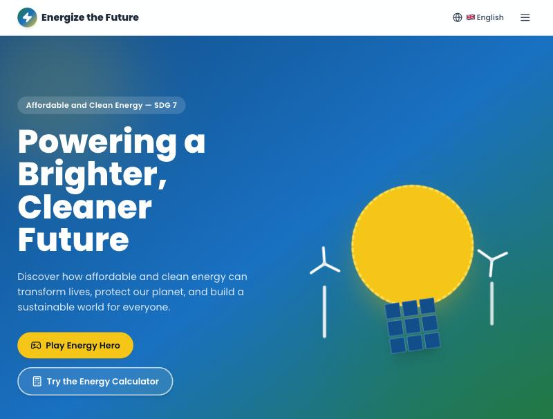
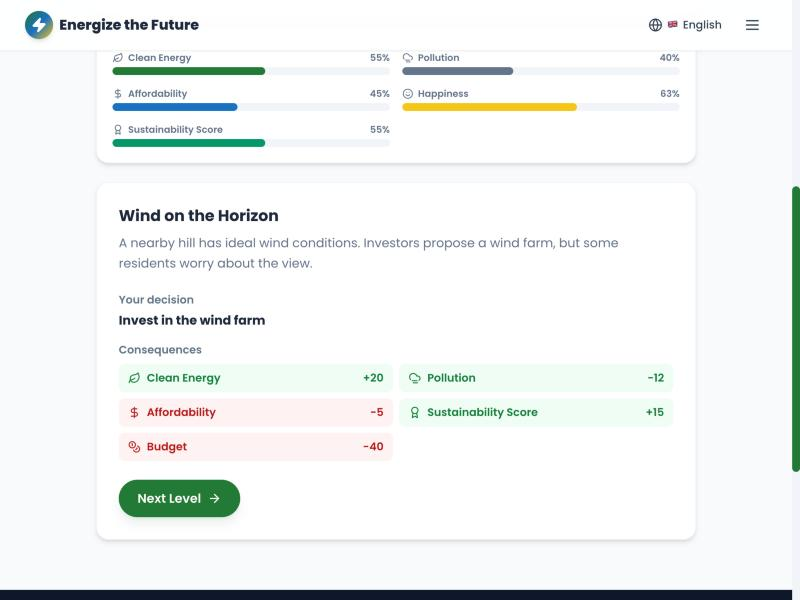
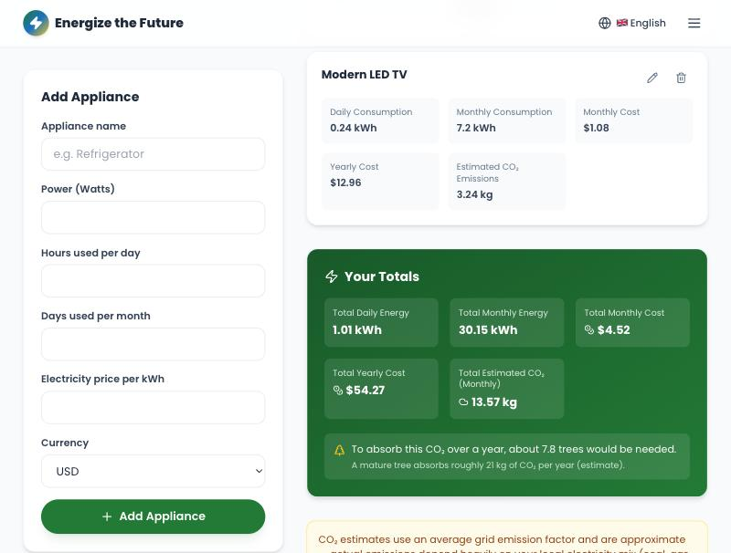
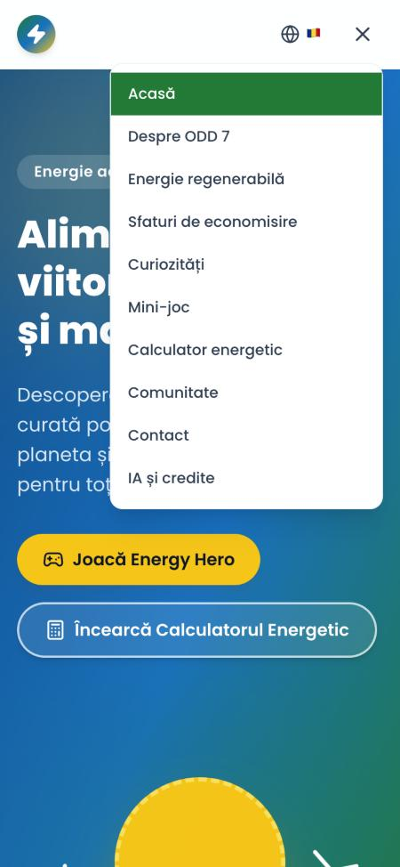
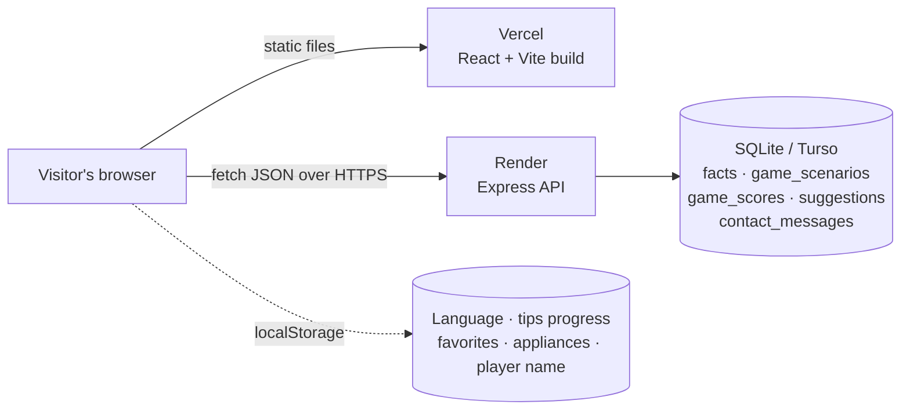

# ⚡ Energize the Future

**Affordable and Clean Energy — UN Sustainable Development Goal 7**

An educational, multilingual (English · Română · Русский) web application that teaches young
people about renewable energy, energy efficiency and how everyone can help build a cleaner
future. It combines clear explanations with things you can *do*: a city-building strategy game,
an energy-cost and CO₂ calculator, a habit tracker and a community suggestion box.

| | |
|---|---|
| 🌐 **Live website** | https://energize-the-future.vercel.app |
| 🔌 **Live API** | https://energize-the-future.onrender.com/api/health |
| 💻 **Source code** | https://github.com/stefaniat2/energize-the-future |

> The API runs on a free hosting tier and sleeps after 15 minutes of inactivity — the first
> request after a pause can take up to ~50 seconds to wake it up.

---

## Contents

1. [What problem does it solve?](#what-problem-does-it-solve)
2. [Features](#features)
3. [Technology](#technology)
4. [Architecture](#architecture)
5. [Quick start](#quick-start)
6. [Configuration](#configuration)
7. [Testing](#testing)
8. [API reference](#api-reference)
9. [Multilingual support](#multilingual-support)
10. [Accessibility](#accessibility)
11. [Security and privacy](#security-and-privacy)
12. [Deployment](#deployment)
13. [Project structure](#project-structure)
14. [Responsible AI use and credits](#responsible-ai-use-and-credits)
15. [Known limitations](#known-limitations)
16. [Further documentation](#further-documentation)

---

## What problem does it solve?

SDG 7 asks the world to give everyone access to **affordable, reliable, sustainable and modern
energy** by 2030. Reading about it is not enough to change habits, so Energize the Future turns
the goal into experiences young people can try in a few minutes:

- **Understand** — plain-language pages on SDG 7, six renewable technologies and their trade-offs.
- **Decide** — *Energy Hero* puts you in charge of a polluted city's energy budget. Every choice
  has visible consequences, and the budget forces real trade-offs.
- **Measure** — the calculator turns watts into money, CO₂ and "how many trees would that take",
  and compares old and efficient appliances using *your* electricity price.
- **Act** — 20 practical energy-saving tips with a progress tracker, and a form to send ideas
  for your own community.

## Features

| Page | What it does |
|---|---|
| **Home** | Animated hero, the three SDG 7 objectives, statistics, source cards, "What can you do?" |
| **About SDG 7** | UN and SDG 7 explained simply, energy poverty, climate, an interactive history timeline, the official targets |
| **Renewable Energy** | Solar, wind, hydro, geothermal, biomass and tidal: how each works, pros/cons, impact, uses, a fun fact, plus a comparison table |
| **Energy-Saving Tips** | 20 tips in 5 categories (home, school, transport, technology, public spaces) with difficulty, savings and a progress ring saved in your browser |
| **Fun Facts** | 35 facts from the database, category filters, random/next, favorites, sharing and a counter |
| **Mini Game — Energy Hero** | 10 levels, budget and timer, 5 live city stats, consequence feedback after every decision, 5 achievements, global leaderboard |
| **Energy Calculator** | Multiple appliances (add / edit / remove, saved locally), daily/monthly/yearly energy, cost in USD/EUR/RON/MDL, CO₂, trees equivalent, efficiency comparison tool |
| **Community** | Validated suggestion form stored in the database |
| **Contact** | Validated contact form stored in the database |
| **AI & Credits** | Transparent statement about AI assistance, sources, licences and privacy |

Cross-cutting: three languages that switch instantly, responsive layout (phone → desktop),
keyboard navigation, skip link, translated page titles, reduced-motion support. The interface
uses the SDG 7 palette (green · blue · yellow) and the Poppins typeface; all illustrations are
drawn with CSS/SVG, so no copyrighted images are used. See the [user guide](docs/USER_GUIDE.md).

## Screenshots

| Home | Energy Hero — consequences of a decision |
|---|---|
|  |  |

| Calculator with totals and trees equivalent | Phone layout, Romanian, menu open |
|---|---|
|  |  |

## Technology

**Frontend** — React 18 · Vite · React Router 6 · Tailwind CSS · i18next / react-i18next · lucide-react icons

**Backend** — Node.js 20 · Express 4 · SQLite via the libSQL client (`@libsql/client`): a local file for development, optionally a free hosted **Turso** database for permanent data · dotenv

**Quality** — Node's built-in test runner (28 automated tests), in-memory database for tests, GitHub Actions CI, Lighthouse audited

**Hosting (free tiers)** — Vercel (frontend) · Render (API)

## Architecture



- The **frontend** is a single-page app. Preferences live in `localStorage`; nothing sensitive is stored.
- The **API** is a small layered Express app: `routes → middleware (validation, rate limit) →
  controllers → database`.
- Content that benefits from being data (facts, game scenarios) lives in SQLite, translated into
  all three languages, and is returned for the requested `?lang=`. The server **seeds itself**
  when it finds those tables empty, so a fresh install or a restarted free-tier host always works.

More detail and design decisions: [docs/ARCHITECTURE.md](docs/ARCHITECTURE.md).

## Quick start

Requirements: **Node.js 20+** and npm. No other software is needed (SQLite is embedded).

```bash
git clone https://github.com/stefaniat2/energize-the-future.git
cd energize-the-future

# 1) Backend (terminal 1)
cd server
npm install
npm run dev            # http://localhost:5001  (database is created and seeded automatically)

# 2) Frontend (terminal 2)
cd client
npm install
npm run dev            # http://localhost:5173
```

Open **http://localhost:5173**. No manual database step is required; `npm run seed` in `server/`
is only needed to force-reset the facts and game levels.

| Where | Command | Purpose |
|---|---|---|
| `server/` | `npm run dev` | API with auto-restart |
| `server/` | `npm start` | API (production) |
| `server/` | `npm test` | 15 API integration tests |
| `server/` | `npm run seed` | Force re-seed facts and game levels |
| `client/` | `npm run dev` | Vite dev server |
| `client/` | `npm run build` | Production build into `client/dist` |
| `client/` | `npm test` | 13 unit tests (formulas, game rules, translations) |

## Configuration

**`server/.env`** (copy `server/.env.example`)

| Variable | Default | Meaning |
|---|---|---|
| `PORT` | `5001` | Port the API listens on (hosts like Render set it automatically) |
| `CLIENT_ORIGIN` | *(empty)* | Extra allowed website origins, comma-separated. `localhost` and `*.vercel.app` are always allowed |
| `DB_PATH` | `./database/energize.db` | Local SQLite file (relative to `server/`, absolute, or `:memory:`), used when `TURSO_DATABASE_URL` is empty |
| `TURSO_DATABASE_URL` | *(empty)* | Hosted Turso database (`libsql://…`) for **permanent** data — see [docs/DEPLOYMENT.md](docs/DEPLOYMENT.md#6-make-data-permanent-turso-free) |
| `TURSO_AUTH_TOKEN` | *(empty)* | Access token for that Turso database |
| `RATE_LIMIT_MAX` | `20` | Max write requests per IP per minute |

**`client/.env`** (copy `client/.env.example`)

| Variable | Default | Meaning |
|---|---|---|
| `VITE_API_URL` | `http://localhost:5001/api` | Base URL of the API (baked in at build time) |

## Testing

```bash
cd server && npm test     # API: endpoints, validation, CORS, rate limit, SQL-injection attempt
cd client && npm test     # formulas, game rules, translation parity
```

- **API** — all endpoints, all three languages, every fact category, leaderboard ordering, input
  validation (including cheating scores), SQL-injection text stored harmlessly, malformed JSON,
  unknown routes, CORS allow/deny, security headers, rate limiting.
- **Calculator** — the exact formulas from the specification, totals, trees equivalent, efficiency savings.
- **Game rules** — stat clamping, scoring formula, budget locking (the player can never be left
  without a choice), achievement thresholds, and that the seeded scenarios are winnable.
- **Translations** — English, Romanian and Russian have identical keys, no empty strings,
  matching `{{placeholders}}`, and no long text left identical to English.

**Continuous integration:** `.github/workflows/ci.yml` runs both test suites and a production build on every push.

**Lighthouse audit** (mobile emulation with throttling, production build, all 10 pages, October 2026):
Accessibility **100** · Best Practices **100** · SEO **100** · Performance **95–98**. The audit found real
problems (low-contrast text, a nameless logo link, skipped heading levels, layout shift while data loaded, an
invalid `robots.txt`) which were fixed — see [AI_USAGE.md](AI_USAGE.md#mistakes-made-by-the-ai-that-testing-caught).

The manual checks done in a real browser are listed in
[docs/ARCHITECTURE.md](docs/ARCHITECTURE.md#testing-strategy).

## API reference

Base URL: `http://localhost:5001/api` (production: `https://energize-the-future.onrender.com/api`).
Responses are JSON: `{ "success": true, "data": ... }` or
`{ "success": false, "message": "...", "errors": ["..."] }`.

| Method | Endpoint | Description |
|---|---|---|
| GET | `/health` | Health check |
| GET | `/facts?lang=en` | All facts in `en`, `ro` or `ru` |
| GET | `/facts/random?lang=en&category=wind` | One random fact (category optional) |
| GET | `/facts/category/:category?lang=en` | Facts of one category (`solar`, `wind`, `climate`, `efficiency`, `hydropower`, `technology`); `404` if unknown |
| GET | `/game/scenarios?lang=en` | The 10 Energy Hero levels with options and effects |
| POST | `/game/scores` | Submit `{ playerName, score, sustainabilityScore, levelsCompleted }` |
| GET | `/game/leaderboard?limit=10` | Top scores (max 50) |
| POST | `/suggestions` | `{ name, email, category, message }` |
| POST | `/contact` | `{ name, email, subject, message }` |

Status codes: `200`/`201` success · `400` validation error (with an `errors` list) · `403` origin not
allowed · `404` not found · `429` too many requests · `500` unexpected error (details never leaked).
Suggestion categories: `renewable-energy`, `energy-efficiency`, `education`, `transportation`,
`community-projects`, `other`.

## Multilingual support

- English (default), Romanian and Russian via i18next; the choice is remembered and applied
  instantly without reloading.
- **471 translation keys per language** in `client/src/locales/{en,ro,ru}/translation.json`,
  guarded by automated tests so a missing or untranslated string is caught immediately.
- Database content (facts, game levels) is stored translated and served by `?lang=`.
- `<html lang>` and the browser-tab title follow the selected language; numbers and currencies
  are formatted with the visitor's locale.

## Accessibility

Semantic landmarks and heading hierarchy · skip-to-content link · every form control labelled ·
visible focus ring · full keyboard operation (menu closes with `Esc`) · ARIA progress bars and live
regions in the game · decorative icons hidden from screen readers · colour never the only signal
(the game also shows `+`/`−` signs) · `prefers-reduced-motion` respected · responsive from 320 px up.

## Security and privacy

- Input validated on the server (types, lengths, e-mail format, allowed categories, score limits).
- Parameterised SQL everywhere; JSON body limited to 10 kB; write endpoints rate limited per IP.
- Strict CORS allow-list; security headers; `X-Powered-By` removed; error details never leaked.
- No accounts, no cookies, no analytics, no trackers. Only data the visitor chooses to submit is
  stored. `.env` files and database files are git-ignored.

## Deployment

Deployed for free on **Vercel** (client) + **Render** (server). Step-by-step instructions, exact
settings, and the problems we met and solved: [docs/DEPLOYMENT.md](docs/DEPLOYMENT.md).

## Project structure

```
energize-the-future/
├── client/                         React + Vite single-page app
│   ├── src/
│   │   ├── components/             Navbar, Footer, LanguageSelector, StatusMessage…
│   │   ├── pages/                  One file per route (10 pages)
│   │   ├── utils/                  energy.js, game.js — pure, unit-tested logic
│   │   ├── hooks/                  useLocalStorage
│   │   ├── services/api.js         fetch() wrapper
│   │   └── locales/{en,ro,ru}/     translations
│   ├── tests/logic.test.js
│   └── vercel.json                 SPA routing rule
├── server/                         Express + SQLite API
│   ├── app.js / server.js          app definition / process entry point
│   ├── routes/ controllers/        routing → logic layers
│   ├── middleware/                 validators, rateLimit, security, errorHandler
│   ├── database/                   db.js (schema + auto-seed), seedData.js, seed.js
│   └── tests/api.test.js
├── docs/                           architecture, user guide, deployment, presentation, stand kit, screenshots
├── .github/workflows/              ci.yml (tests + build), keep-alive.yml (optional API ping)
├── AI_USAGE.md                     how AI was used, prompts, human review
├── LICENSE                         MIT
└── README.md
```

## Responsible AI use and credits

This project was built with an AI coding assistant (**Claude Code**, Anthropic, Claude Sonnet
models) under the team's direction. The tools, the prompts, what the AI did versus what people
did, how results were verified, and the licences of everything used are documented in
**[AI_USAGE.md](AI_USAGE.md)** and summarised inside the app on the *AI & Credits* page.

Facts are based on public UN, IEA and IRENA information. Open-source libraries: React, Vite,
Tailwind CSS, React Router, i18next, lucide-react (ISC), Express, @libsql/client (MIT) and the
Poppins font (SIL OFL).

## Known limitations

- **Free hosting:** the API sleeps when idle (slow first request; the optional `keep-alive` workflow
  prevents it). Without a hosted database its disk is not persistent, so submitted scores and
  suggestions can be lost when the host restarts. Facts and game levels are unaffected because the
  server re-seeds itself. Setting the two `TURSO_*` variables switches to a free hosted database and
  makes all data permanent (the Turso path was verified for connection handling and fails fast on bad
  credentials; the local-file path is the one covered by the automated tests).
- CO₂ figures use one average emission factor (0.45 kg/kWh); real values depend on each country's
  electricity mix, as the app states.
- Statistics are approximate and change; always check the official sources.
- `npm audit` reports moderate advisories in dev tooling (Vite/esbuild, React Router) that need
  breaking major upgrades; they do not affect the built, deployed site.

## License

[MIT](LICENSE) — free to use, study and adapt, with attribution.

## Further documentation

| Document | For |
|---|---|
| [docs/USER_GUIDE.md](docs/USER_GUIDE.md) | Using every page and feature |
| [docs/ARCHITECTURE.md](docs/ARCHITECTURE.md) | Design decisions, data model, game formulas, testing strategy |
| [docs/DEPLOYMENT.md](docs/DEPLOYMENT.md) | Publishing for free and troubleshooting |
| [AI_USAGE.md](AI_USAGE.md) | Responsible AI usage, prompts, review checklist |
| [docs/PRESENTATION.md](docs/PRESENTATION.md) | Talk script, live demo, likely questions |
| [docs/STAND.md](docs/STAND.md) | Stand layout and printable poster |
